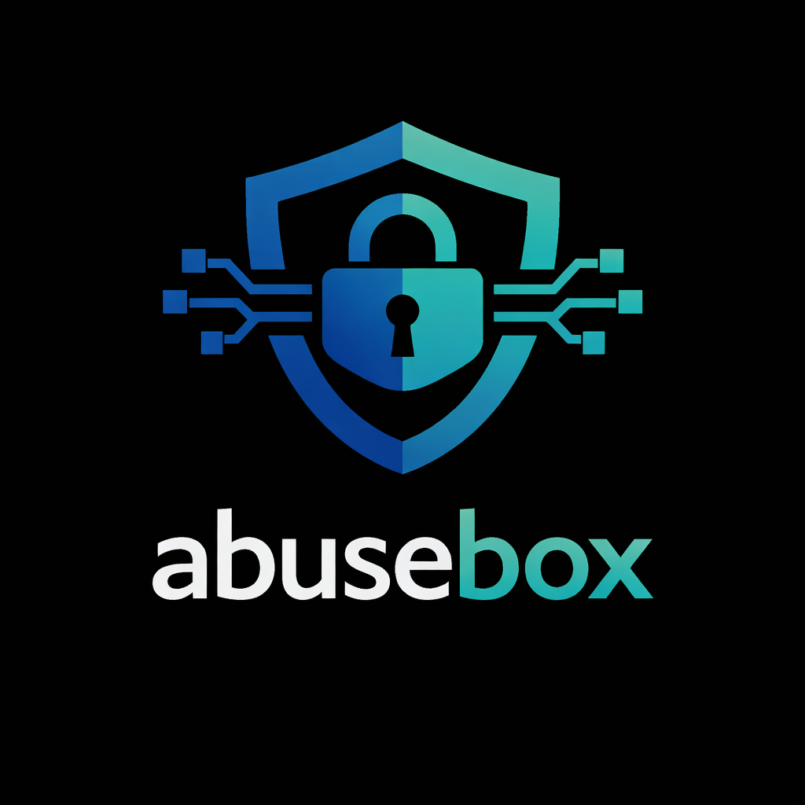
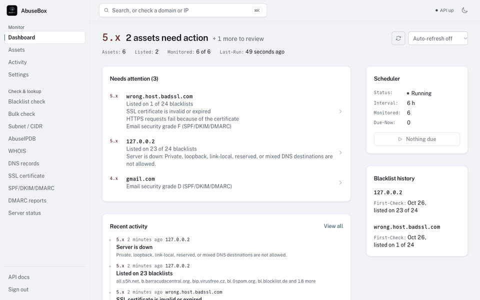

<div align="center">



# AbuseBox

**Know your mail server is blacklisted before your users do.**

Self-hosted monitoring for the IPs and domains you run: 24 DNS blacklists, SSL and domain expiry, SPF/DKIM/DMARC and uptime, with an alert when something changes.

[Website](https://bekkaze.github.io/abusebox/) &nbsp;|&nbsp; [Quick start](#quick-start) &nbsp;|&nbsp; [Changelog](CHANGELOG.md)

[](https://github.com/bekkaze/abusebox/releases)
[](https://github.com/bekkaze/abusebox/actions/workflows/ci.yml)
[](https://github.com/bekkaze?tab=packages&repo_name=abusebox)
[](LICENSE)
[](https://github.com/bekkaze/abusebox/stargazers)

</div>



## Quick start

```bash
git clone https://github.com/bekkaze/abusebox.git && cd abusebox
docker compose up -d
```

Open `http://localhost:3000` and sign in as `admin` / `password123`, then change the password in Settings. More options under [Installation](#installation).

## Why AbuseBox

- **Results you can trust.** Before trusting a blacklist, AbuseBox checks it against its test addresses (RFC 5782). A list that refuses your resolver shows **No answer**, not a false "clean". Try it: through Google DNS, Spamhaus says "not listed" for everything.
- **Every listing explained.** Spamhaus SBL (a spam source) and PBL (an end-user range) are not the same problem. Each listing comes with its meaning and a severity, so you know what to fix first.
- **Mail-server health in one place.** 24 blacklists, AbuseIPDB, SSL and domain expiry, SPF/DKIM/DMARC grades, DMARC reports and uptime.
- **Tells you what changed.** Scheduled checks, an activity log, and alerts by email, Slack, Discord or webhook when something is listed, delisted, goes down or is about to expire.
- **Yours.** Self-hosted, MIT licensed, no telemetry, no paid tier.

If AbuseBox saves you a bounce, a star helps other mail operators find it.

---

## Features

**Monitoring**
- Add IPs and domains as assets (one by one, a list of up to 300, or a whole /24) and choose which checks run on each
- Scheduled re-checks on a global or per-asset interval, plus a "check due assets now" button
- A dashboard that opens on what needs action: listings, invalid or expiring certificates, expiring domains, servers down, weak email security
- An activity log of every change, check history with what changed between checks, and blacklist history charts
- Alerts by email, Slack, Discord or webhook for new listings, removals, outages, recoveries and expiry warnings

**Checks**
- **Blacklists:** 24 DNS blacklists, each listing decoded with its meaning and a severity, and each list verified against its test addresses
- **AbuseIPDB:** abuse confidence score, reports, ISP and country (free API key)
- **SSL:** validity, issuer, expiry, cipher and covered names
- **WHOIS:** registrar, dates and name servers
- **DNS:** A, AAAA, MX, TXT, CNAME, NS, SOA and PTR records
- **SPF / DKIM / DMARC:** graded A to F, with custom DKIM selectors, plus DMARC aggregate report parsing
- **Server status:** DNS resolution, ports 80 and 443, HTTP status and response time
- **Bulk and subnet checks:** up to 300 targets at once, or every address in a /24

**Day to day**
- Delist tracking with links to each blacklist's removal page
- Table or card view, search, filters, sorting, bulk actions and CSV export
- Command palette (Ctrl/Cmd + K), light and dark themes, a mobile layout
- Multiple users with admin roles, optional history retention, and a REST API with Swagger docs
- A public quick-check page (rate limited) that needs no account; everything else requires sign-in

---

## Installation

### Docker (recommended)

```bash
git clone https://github.com/bekkaze/abusebox.git
cd abusebox
cp backend/.env.example .env    # optional: alerts, API keys, admin account
docker compose up -d            # pulls the prebuilt images (add --build to build from source)
```

Open `http://localhost:3000` and you're ready to go. To update later: `docker compose pull && docker compose up -d`.

> Default login: `admin` / `password123`. **Change it in Settings right after the first sign-in.**
>
> The UI answers on any hostname, so you can open it from another machine right away. Put it behind your own HTTPS reverse proxy before exposing it to a network you don't trust.

### Manual Setup

<details>
<summary>Click to expand</summary>

**Prerequisites:** Python 3.11+, Node.js 20.19+, Yarn

**Backend:**

```bash
cd backend
cp .env.example .env
pip install -r requirements.txt
uvicorn app.main:app --host 0.0.0.0 --port 8100 --reload
```

**Frontend** (new terminal):

```bash
cd frontend
cp .env.example .env
yarn install
yarn dev
```

Open `http://localhost:3000`.

</details>

<a id="upgrading-to-v130"></a>

### Upgrading

```bash
docker compose pull && docker compose up -d
```

The database is migrated automatically on start, and your data is kept. (Built from source? `git pull && docker compose up -d --build`.)

**Notes for v1.3.0**

- **The frontend is now a production build served by nginx**, not the Vite dev server. `VITE_ALLOWED_HOSTS`, `VITE_BASE_URL` and `VITE_API_DOCS_URL` in `.env` are no longer used and can be removed. The API docs moved to `http://localhost:3000/api/swagger/`.
- **Database migrations now use Alembic.** Existing databases are detected and upgraded on the first start.
- **ISPs and other commercial users need a Spamhaus key.** Set `SPAMHAUS_DQS_KEY` (see [Configuration](#configuration)).

<details>
<summary>Upgrading from v1.1.x</summary>

Back up your data first, then pull the new version. The database is migrated automatically on start.

```bash
# The volume is named <folder>_abusebox-data; `docker volume ls` shows it.
docker run --rm -v abusebox_abusebox-data:/data -v "$PWD":/backup alpine tar czf /backup/abusebox-data.tgz -C /data .
git pull
docker compose up -d --build
```

Things that changed:

- **Everyone is signed out once.** Older Docker setups used a published JWT secret; v1.2.0 generates a private one (or uses your `APP_SECRET_KEY`).
- **Change the admin password.** Older Docker setups ignored `DEFAULT_ADMIN_PASSWORD` from `.env`, so the admin account probably still uses `password123`. A banner reminds you until you change it in **Settings → Password**.
- **The `/tools/*` API needs a token.** Only `/blacklist/quick-check/` stays public. See [API Endpoints](#api-endpoints).
- **No public sign-up.** Admins add users in **Settings → Users**.
- **The scheduler is on by default** unless you turned it off in Settings before.

</details>

---

## Configuration

Create a `.env` file in the project root (Docker Compose reads it automatically, and values in it override the compose defaults):

```env
# Leave empty to auto-generate a secret (stored next to the database)
APP_SECRET_KEY=
APP_DEBUG=false
APP_CORS_ALLOWED_ORIGINS=http://localhost:3000
DATABASE_URL=sqlite:///./app.db   # ignored by Docker Compose (always uses the data volume)

# Default admin, created on first start only
DEFAULT_ADMIN_USERNAME=admin
DEFAULT_ADMIN_PASSWORD=password123
DEFAULT_ADMIN_EMAIL=admin@abusebox.local
DEFAULT_ADMIN_PHONE=11111111

# Optional: AbuseIPDB (free key at https://www.abuseipdb.com/account/api)
ABUSEIPDB_API_KEY=

# Optional: Spamhaus Data Query Service key (required for commercial use, including ISPs)
SPAMHAUS_DQS_KEY=
# Optional: your own DNS resolver for blacklist lookups
DNSBL_NAMESERVERS=

# Scheduled monitoring
SCHEDULER_ENABLED=true
SCHEDULER_INTERVAL_MINUTES=360

# Email alerts (optional)
SMTP_HOST=
SMTP_PORT=587                  # 587 uses STARTTLS; 465 uses TLS from the start
SMTP_USERNAME=
SMTP_PASSWORD=
SMTP_FROM_EMAIL=
SMTP_USE_TLS=true

# Webhook alerts (optional)
WEBHOOK_URL=
```

| Variable | Description | Required |
|---|---|---|
| `APP_SECRET_KEY` | JWT signing secret. If unset, a random one is generated and saved as `.secret_key` next to the database | No |
| `APP_DEBUG` | Show error tracebacks (development only) | No |
| `APP_CORS_ALLOWED_ORIGINS` | Comma-separated browser origins allowed to call the API | No |
| `DATABASE_URL` | Database connection string (SQLite default) | No |
| `ABUSEIPDB_API_KEY` | Enables AbuseIPDB reputation checks | No |
| `SCHEDULER_ENABLED` | Run periodic background checks (default: `true`; can also be changed in Settings) | No |
| `SCHEDULER_INTERVAL_MINUTES` | Check interval in minutes (default: 360) | No |
| `SMTP_HOST` | SMTP server for email alerts. Alerts go to the email address of the asset's owner; each user sets theirs in **Settings → Notifications** | No |
| `WEBHOOK_URL` | Webhook URL for alerts (Slack and Discord URLs get chat messages). A URL set in Settings → Notifications takes precedence | No |
| `DNSBL_NAMESERVERS` | Comma-separated DNS resolvers (IPs or hostnames) for blacklist lookups. Spamhaus and some others refuse public resolvers; see [Blacklists that show "No answer"](#blacklists-that-show-no-answer) | No |
| `SPAMHAUS_DQS_KEY` | Spamhaus [Data Query Service](https://www.spamhaus.com/data-access/free-data-query-service/) key. When set, Spamhaus lookups use your key instead of the public mirror. Spamhaus's free public mirror is for non-commercial use only; ISPs and commercial users need a paid key | No |

> DNS Records, SSL Checker, WHOIS, SPF/DKIM/DMARC, and Server Status work out of the box with no API keys.

### Blacklists that show "No answer"

Each check also asks every blacklist about its test addresses: 127.0.0.2 must be listed and 127.0.0.1 must not be. A blacklist that gets either wrong, times out or returns a refusal code is shown as **No answer**, and its result (clean or listed) is ignored.

The usual cause is the DNS resolver. Spamhaus (`zen.spamhaus.org`) does not answer large public resolvers honestly: through Google DNS it says "not listed" for everything, and through Cloudflare it returns an error code. Other lists rate limit public resolvers. Run your own recursive resolver so the blacklists see your server's IP. For Docker, a `docker-compose.override.yml` next to `docker-compose.yml`:

```yaml
services:
  unbound:
    image: klutchell/unbound
    restart: unless-stopped
  backend:
    depends_on:
      - unbound
```

and in `.env`:

```env
DNSBL_NAMESERVERS=unbound
```

Frontend: the Docker image serves the built UI with nginx and proxies `/api` to `BACKEND_URL` (default `http://backend:8100`). For the development server (`yarn dev`), `frontend/.env` sets:

| Variable | Description |
|---|---|
| `VITE_BASE_URL` | Backend URL for the dev server's `/api` proxy (default: `http://localhost:8100`) |
| `VITE_ALLOWED_HOSTS` | Hostnames the dev server answers to (default: `localhost,127.0.0.1`) |

---

## API Endpoints

Only the blacklist quick check is public (rate limited to 10 requests per minute per IP). Every other endpoint needs a bearer token from `POST /user/login/`:

```
GET  /blacklist/quick-check/?hostname=example.com      # public
GET  /tools/abuseipdb/?hostname=8.8.8.8
GET  /tools/whois/?hostname=example.com
GET  /tools/dns/?hostname=example.com
GET  /tools/ssl/?hostname=example.com
GET  /tools/email-security/?hostname=example.com&dkim_selectors=s1,s2
GET  /tools/server-status/?hostname=example.com
GET  /tools/subnet/?cidr=203.0.113.0/24
POST /tools/bulk-check/                  # {"hostnames": ["example.com", "8.8.8.8"]}
POST /tools/bulk-check-upload/           # multipart file: .txt, .csv or .xlsx
GET  /tools/export/blacklist/?hostname=example.com
GET  /tools/export/subnet/?cidr=203.0.113.0/24
POST /hostname/bulk/                     # up to 300 assets
POST /hostname/cidr-import/
POST /hostname/{id}/recheck/
POST /hostname/bulk-action/             # {"ids": [1, 2], "action": "recheck"}
GET  /hostname/list/?include_result=false
GET  /hostname/{id}/checks/{check_id}
GET  /hostname/{id}/events/
GET  /events/?severity=critical
GET  /settings/scheduler/status/
POST /settings/scheduler/run/            # admin only: check due assets now
PUT  /settings/notifications/            # admin only
POST /settings/notifications/test/       # admin only
POST /user/change-password/
POST /user/create/                       # admin only
GET  /user/list/                         # admin only
PATCH /user/{id}/                        # admin only
```

```bash
TOKEN=$(curl -s -X POST localhost:8100/user/login/ -H 'Content-Type: application/json' \
  -d '{"username":"admin","password":"your-password"}' | jq -r .access)
curl -s -H "Authorization: Bearer $TOKEN" "localhost:8100/tools/dns/?hostname=example.com"
```

Full interactive docs available after startup:

- **Swagger UI:** `http://localhost:3000/api/swagger/` (or `http://localhost:8100/swagger/` on the backend directly)
- **ReDoc:** `http://localhost:3000/api/redoc/`

---

## Tech Stack

| Layer | Technology |
|---|---|
| Backend | Python 3.11, FastAPI, SQLAlchemy 2 + Alembic, PyJWT, dnspython |
| Frontend | React 18, React Router 7, Vite 6, Tailwind CSS 3, Headless UI, Recharts; served by nginx |
| Database | SQLite (swappable via `DATABASE_URL`) |
| Deployment | Docker + Docker Compose; multi-arch images (amd64, arm64) on GHCR: `:latest` = newest stable release, `:edge` = main |
| CI | GitHub Actions: backend tests, frontend lint and build |

---

## Project Structure

```
abusebox/
├── backend/
│   ├── app/
│   │   ├── api/routers/       # auth, blacklist, dmarc, events, hostname, settings, tools
│   │   ├── core/              # config, JWT security, SSRF guards, client IP, UTC helpers
│   │   ├── db/                # SQLAlchemy session, Alembic migrations, seed data
│   │   ├── models/            # users, assets, check history, events, DMARC, settings
│   │   ├── schemas/           # Pydantic schemas
│   │   └── services/          # checks: dnsbl, abuseipdb, dns, ssl, whois, email security,
│   │                          #   server status, subnet, DMARC parser, export
│   │                          # monitoring: monitoring (save + events + alerts), health,
│   │                          #   events, scheduler, notifications
│   └── tests/                 # pytest (offline suite + live DNSBL cross-checks)
├── frontend/
│   └── src/
│       ├── pages/             # Landing, Login, Dashboard, Assets, Asset detail, Activity,
│       │                      # Settings, Check & Lookup tools
│       ├── components/        # shared UI (forms, alerts, activity feed, command palette),
│       │                      # dashboard, blacklist tables, dialogs
│       ├── services/          # API clients, auth, theme, current user
│       └── routes/            # React Router config
│   ├── nginx/                 # production web server config (serves the UI, proxies /api)
├── site/                      # project website (GitHub Pages)
├── files/                     # logo, demo GIF and screenshots
├── docker-compose.yml
└── .env                       # your configuration (not committed)
```

---

## Releases

| Version | Date | Highlights |
|---|---|---|
| **v1.3.1** | October 26, 2026 | Email alerts reach a real address (each user sets theirs in Settings, #28), SMTP on port 465, certifi security update |
| **v1.3.0** | October 26, 2026 | Redesigned interface (delivery-report results, table-first assets, self-hosted fonts), decoded blacklist listings with severity, 24 lists, Spamhaus key support, nginx production frontend, Alembic migrations |

Older releases and full details: [CHANGELOG.md](CHANGELOG.md).

---

## Contributing

Issues and pull requests are welcome. Issues labelled [good first issue](https://github.com/bekkaze/abusebox/labels/good%20first%20issue) are a good way in; read [CONTRIBUTING.md](CONTRIBUTING.md) for the setup and checks. Questions and ideas go to [Discussions](https://github.com/bekkaze/abusebox/discussions).

## Security

Found a vulnerability? Please report it privately, as described in [SECURITY.md](SECURITY.md).

## License

MIT. See [LICENSE](LICENSE).
