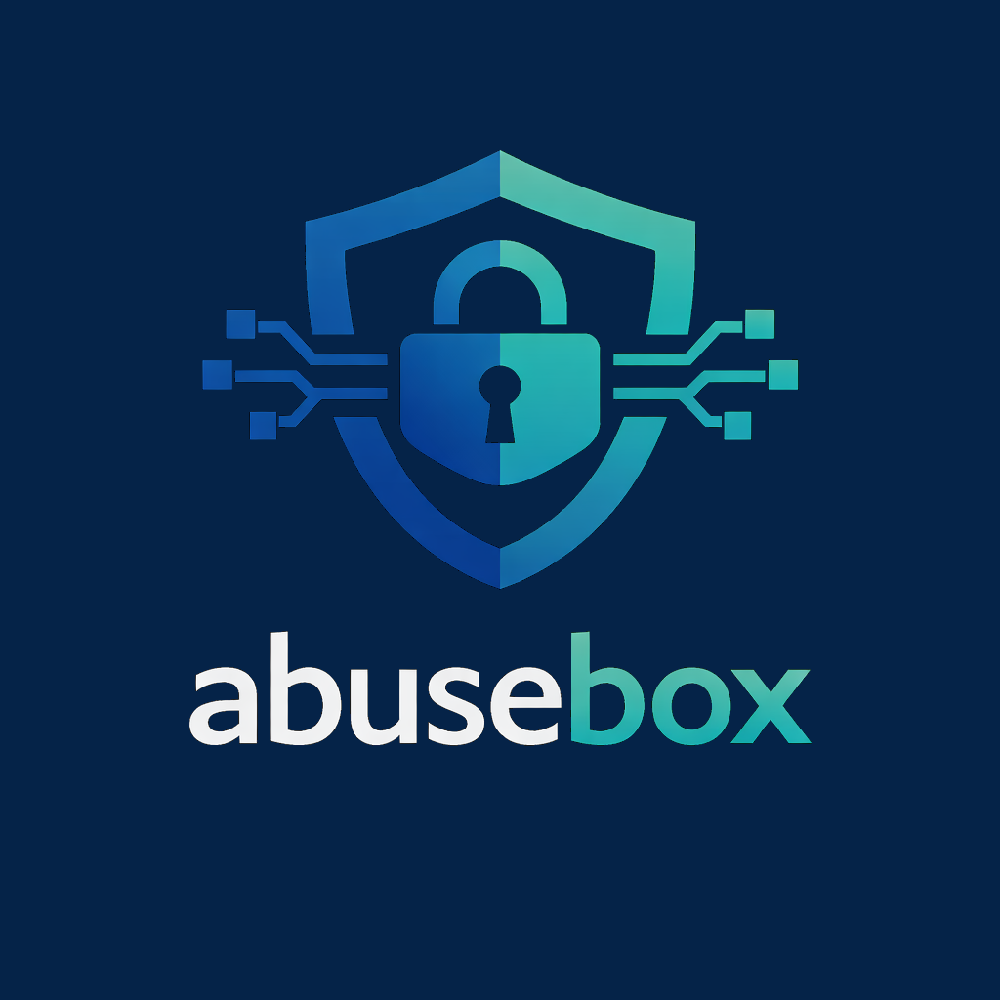
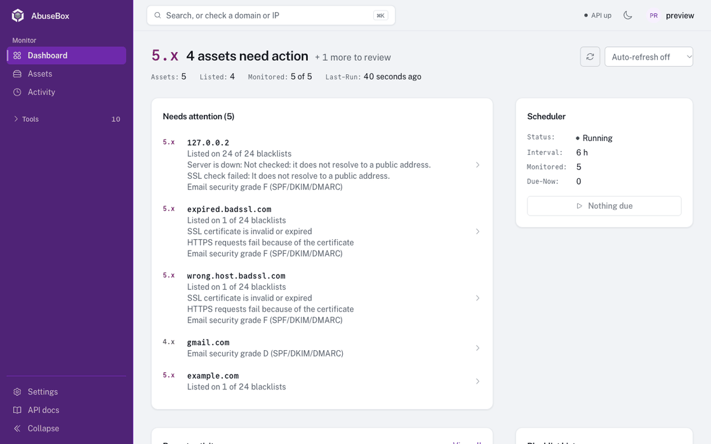

<div align="center">



# AbuseBox

**Know your mail server is blacklisted before your users do.**

Self-hosted monitoring for the IPs and domains you run: 27 DNS blacklists across IPv4, IPv6 and domain names, SSL and domain expiry, SPF/DKIM/DMARC and uptime, with an alert when something changes.

[Website](https://bekkaze.github.io/abusebox/) &nbsp;|&nbsp; [Quick start](#quick-start) &nbsp;|&nbsp; [Changelog](CHANGELOG.md)

[](https://github.com/bekkaze/abusebox/releases)
[](https://github.com/bekkaze/abusebox/actions/workflows/ci.yml)
[](https://github.com/bekkaze?tab=packages&repo_name=abusebox)
[](LICENSE)
[](https://github.com/bekkaze/abusebox/stargazers)

</div>



## Quick start

```bash
git clone https://github.com/bekkaze/abusebox.git && cd abusebox
docker compose up -d
```

Open `http://localhost:3000` and sign in as `admin` with the password from `docker compose exec backend cat /app/data/initial_admin_password`, then change it in Settings. More options under [Installation](#installation).

## Why AbuseBox

- **Results you can trust.** Before trusting a blacklist, AbuseBox checks it against its test addresses (RFC 5782). A list that refuses your resolver shows **No answer**, not a false "clean". Try it: through Google DNS, Spamhaus says "not listed" for everything.
- **Every listing explained.** Spamhaus SBL (a spam source) and PBL (an end-user range) are not the same problem. Each listing comes with its meaning and a severity, so you know what to fix first.
- **Mail-server health in one place.** 27 blacklists, AbuseIPDB, SSL and domain expiry, SPF/DKIM/DMARC grades, DMARC reports and uptime.
- **Ranked by what actually matters.** Every asset gets a risk score out of 100, weighted by the severity each blacklist's own return codes decode to, so one critical listing outranks three cosmetic ones. The score shows its working: every factor, what it contributed, and out of what.
- **Tells you what changed.** Scheduled checks, an activity log, and alerts by email, Slack, Discord or webhook when something is listed, delisted, goes down or is about to expire.
- **Yours.** Self-hosted, MIT licensed, no telemetry, no paid tier.

If AbuseBox saves you a bounce, a star helps other mail operators find it.

---

## Features

**Monitoring**
- Add IPs and domains as assets (one by one, a list of up to 300, or a whole /24) and choose which checks run on each
- Scheduled re-checks on a global or per-asset interval, plus a "check due assets now" button
- A dashboard that opens on what needs action, ordered by a 0-100 risk score built from each asset's own findings
- A risk score per asset with its factors broken out: blacklists, reachability, certificate, domain, email authentication and reputation
- An activity log of every change, check history with what changed between checks, and blacklist history charts
- Alerts by email, Slack, Discord or webhook for new listings, removals, outages, recoveries and expiry warnings

**Checks**
- **Blacklists:** 24 IPv4 lists, 5 of them answering IPv6 as well, plus Spamhaus DBL, SURBL and URIBL for domain names. Every listing is decoded with its meaning and a severity, and every list verified against its own test points
- **AbuseIPDB:** abuse confidence score, reports, ISP and country (free API key)
- **SSL:** validity, issuer, expiry, covered names, and whether the TLS version and cipher are still acceptable
- **WHOIS:** registrar, dates, name servers and abuse contact, over IPv6 or IPv4
- **DNS:** A, AAAA, MX, TXT, CNAME, NS, SOA and PTR records
- **SPF / DKIM / DMARC:** graded A to F, with custom DKIM selectors, plus DMARC aggregate report parsing. A mail server's own hostname is handled: its SPF is read where it is published, and the DMARC policy and DKIM key it is covered by are found on the domain it belongs to
- **Server status:** DNS resolution, ports 80 and 443, HTTP status and response time
- **Bulk and subnet checks:** up to 300 targets at once, or every address in a /24

**Day to day**
- Delist tracking with links to each blacklist's removal page
- Table or card view, with search, filters, sorting and paging all done on the server, so page one is the top of the real order however many assets you have
- An owner per asset, searchable alongside hostname, type and description
- Bulk actions and CSV export
- Command palette (Ctrl/Cmd + K), light and dark themes, a mobile layout
- Multiple users with admin roles, optional history retention, and a REST API with Swagger docs
- A public quick-check page (rate limited) that needs no account; everything else requires sign-in

---

## Installation

### Docker (recommended)

```bash
git clone https://github.com/bekkaze/abusebox.git
cd abusebox
cp backend/.env.example .env    # optional: alerts, API keys, admin account
docker compose up -d            # pulls the prebuilt images (add --build to build from source)
```

Open `http://localhost:3000` and you're ready to go.

> **First sign-in:** the user is `admin`, and the first start generates a random password. Read it with `docker compose exec backend cat /app/data/initial_admin_password`; the backend log names the file but no longer prints the password itself, so a log you share with someone does not hand them the account. **Change it in Settings right after signing in**; the saved copy is deleted when you do. To choose it yourself, set `DEFAULT_ADMIN_PASSWORD` in `.env` before the first start. If the data path is not writable the account is not created at all, and the log says so rather than putting the password in it.
>
> The UI answers on any hostname, so you can open it from another machine right away. Put it behind your own HTTPS reverse proxy before exposing it to a network you don't trust.

### Manual Setup

<details>
<summary>Click to expand</summary>

**Prerequisites:** Python 3.11+, Node.js 20.19+, Yarn

**Backend:**

```bash
cd backend
cp .env.example .env
pip install -r requirements.txt
uvicorn app.main:app --host 127.0.0.1 --port 8100 --reload
```

The first start generates an admin password and saves it next to the database, as `initial_admin_password`. This terminal names the exact path.

**Frontend** (new terminal):

```bash
cd frontend
cp .env.example .env
yarn install
yarn dev
```

Open `http://localhost:3000`.

`frontend/.env` configures the dev server: `VITE_BASE_URL` is the backend it proxies `/api` to (default `http://localhost:8100`), and `VITE_ALLOWED_HOSTS` is the hostnames it answers to (default `localhost,127.0.0.1`). The Docker image does not use either; it serves the built UI with nginx and proxies `/api` to `BACKEND_URL`.

</details>

### Unraid

Templates for Unraid's Community Applications live in [`templates/unraid/`](templates/unraid/). AbuseBox runs as two containers, so install both:

1. Copy `abusebox-backend.xml` and `abusebox-frontend.xml` into `/boot/config/plugins/dockerMan/templates-user/` on the server (or add this repository under **Docker → Template repositories**).
2. Add **AbuseBox-Backend** first. Set **Data** to a path you back up, such as `/mnt/user/appdata/abusebox`, and set **Allowed browser origins** to the address you will open AbuseBox at, for example `http://192.168.1.10:3000`.
3. Add **AbuseBox-Frontend**. Set **Backend URL** to the server's LAN IP and the backend's port, for example `http://192.168.1.10:8100`. Not `localhost` — that points at the frontend container itself.
4. Open `http://<your-server>:3000`. The admin password is in `initial_admin_password` in the data path you chose; the AbuseBox-Backend log names the file. Read it from **Docker → AbuseBox-Backend → Console** with `cat /app/data/initial_admin_password`, or from the share over SMB.

Unraid has no bundled resolver, so **Blacklist resolvers** is empty by default and the server's own resolver is used. If blacklists show "No answer", see [Blacklists that show "No answer"](#blacklists-that-show-no-answer).

### Portainer

[`templates/portainer/`](templates/portainer/) has an app template and a self-contained compose file (no build contexts, no bind mounts).

- **App template:** in Portainer, **Settings → App Templates**, set the URL to `https://raw.githubusercontent.com/bekkaze/abusebox/main/templates/portainer/template.json`, then deploy **AbuseBox** from **App Templates**.
- **Or as a stack:** **Stacks → Add stack → Repository**, repository URL `https://github.com/bekkaze/abusebox`, compose path `templates/portainer/docker-compose.yml`.

Set **Allowed browser origins** to the address you open AbuseBox at, then go to `http://<your-server>:3000`. For the admin password, open the backend container's **Console** in Portainer and run `cat /app/data/initial_admin_password`.

### CasaOS

[`templates/casaos/docker-compose.yml`](templates/casaos/docker-compose.yml) is a self-contained CasaOS app.

1. In CasaOS, **App Store → Custom Install** (the `+` in the top right), choose **Import** and paste the file's contents.
2. Install, then open AbuseBox from the dashboard at port 3000.
3. In the app's settings, set `APP_CORS_ALLOWED_ORIGINS` to the address you open AbuseBox at, for example `http://192.168.1.10:3000`, or the browser will block the API calls.

Data lives in `/DATA/AppData/abusebox/data`. The admin password is in `initial_admin_password` in that folder, which you can open in the CasaOS file manager.

### Upgrading

```bash
docker compose pull && docker compose up -d
```

The database is migrated automatically on start, and your data is kept. (Built from source? `git pull && docker compose up -d --build`.)

Most releases need nothing else. The few that do are below, and the [changelog](CHANGELOG.md) has the full detail for every version.

<details>
<summary>Manual steps for releases before 1.3.5</summary>

<a id="upgrading-to-v130"></a>
<a id="upgrading-from-v11x"></a>

**v1.3.4** — nothing required. Two additions live in the repository rather than the images, so `git pull` as well if you want them: the commented-out **`enable_ipv6`** block at the end of `docker-compose.yml` (see [WHOIS that times out](#whois-that-times-out)), and the **install templates** for Unraid, Portainer and CasaOS in `templates/`.

**v1.3.2** — `git pull` as well as pulling the images: `docker-compose.yml` adds a DNS resolver (Unbound) for blacklist lookups, see [Blacklists that show "No answer"](#blacklists-that-show-no-answer). The backend's port 8100 now listens on this machine only, so scripts elsewhere should call the API through port 3000. The backend container runs as an unprivileged user and takes ownership of the data volume on first start, so no action is needed. Still on `password123`? It keeps working, with a banner asking you to change it.

**v1.3.0** — the frontend is a production build served by nginx, so `VITE_ALLOWED_HOSTS`, `VITE_BASE_URL` and `VITE_API_DOCS_URL` in `.env` are unused and can be removed; the API docs moved to `http://localhost:3000/api/swagger/`. Migrations moved to Alembic and existing databases are upgraded on first start. ISPs and other commercial users need `SPAMHAUS_DQS_KEY` set, see [Configuration](#configuration).

**From v1.1.x** — everyone is signed out once, because older Docker setups used a published JWT secret. The admin account probably still uses `password123`; change it in **Settings → Password**. The `/tools/*` API needs a token now, only `/blacklist/quick-check/` stays public. Public sign-up is gone, so admins add users in **Settings → Users**. The scheduler is on by default. Back up first:

```bash
# The volume is named <folder>_abusebox-data; `docker volume ls` shows it.
docker run --rm -v abusebox_abusebox-data:/data -v "$PWD":/backup alpine tar czf /backup/abusebox-data.tgz -C /data .
```

</details>

---

## Configuration

AbuseBox runs with no configuration. To change anything, copy the full example and edit it:

```bash
cp backend/.env.example .env
```

Docker Compose reads `.env` from the project root automatically, and values in it override the compose defaults. The settings most installs touch:

```env
APP_CORS_ALLOWED_ORIGINS=http://localhost:3000   # the address you open AbuseBox at
DEFAULT_ADMIN_PASSWORD=                          # empty generates a random one
ABUSEIPDB_API_KEY=                               # optional, free key
SPAMHAUS_DQS_KEY=                                # required for commercial use, including ISPs
ABUSIX_API_KEY=                                  # optional: adds Abusix Guardian Mail
SMTP_HOST=                                       # optional, for email alerts
```

Everything available:

| Variable | Description | Default |
|---|---|---|
| `APP_SECRET_KEY` | JWT signing secret. If unset, a random one is generated and saved as `.secret_key` next to the database | generated |
| `APP_DEBUG` | Show error tracebacks (development only) | `false` |
| `APP_CORS_ALLOWED_ORIGINS` | Comma-separated browser origins allowed to call the API | `http://localhost:3000` |
| `DATABASE_URL` | Database connection string. Ignored by Docker Compose, which always uses the data volume | SQLite |
| `DEFAULT_ADMIN_USERNAME` | Admin account created on the first start only | `admin` |
| `DEFAULT_ADMIN_PASSWORD` | Password for that account. If empty, a random one is generated and saved as `initial_admin_password` next to the database, readable only by the backend's user | generated |
| `DEFAULT_ADMIN_EMAIL`, `DEFAULT_ADMIN_PHONE` | Contact details for that account. The email is where its alerts go, and each user can change their own in **Settings → Notifications** | `admin@abusebox.local` |
| `ABUSEIPDB_API_KEY` | Enables AbuseIPDB reputation checks ([free key](https://www.abuseipdb.com/account/api)) | unset |
| `SPAMHAUS_DQS_KEY` | Spamhaus [Data Query Service](https://www.spamhaus.com/data-access/free-data-query-service/) key. When set, Spamhaus lookups use your key instead of the public mirror. The free public mirror is for non-commercial use only; ISPs and commercial users need a paid key | unset |
| `ABUSIX_API_KEY` | Abusix Guardian Mail (formerly Mail Intelligence) key. When set, `combined.mail.abusix.zone` is queried as well. Free for low volume; sign up at [abusix.com](https://abusix.com/) | unset |
| `DNSBL_NAMESERVERS` | Comma-separated DNS resolvers for blacklist lookups. Docker Compose sets this to its bundled `unbound`. Spamhaus and some others refuse public resolvers; see [Blacklists that show "No answer"](#blacklists-that-show-no-answer) | bundled resolver |
| `SCHEDULER_ENABLED` | Run periodic background checks. Can also be changed in Settings | `true` |
| `SCHEDULER_INTERVAL_MINUTES` | How often the scheduler checks due assets | `360` |
| `WHOIS_TIMEOUT_SECONDS` | Total seconds for one WHOIS lookup, split evenly across IPv6 and IPv4. Some registries block a client on one family and answer it on the other | `30` |
| `WHOIS_CACHE_MINUTES` | How long a successful WHOIS answer is reused before asking again. `0` disables caching | `360` |
| `SMTP_HOST` | SMTP server for email alerts. Alerts go to the email address of the asset's owner; each user sets theirs in **Settings → Notifications** | unset |
| `SMTP_PORT` | `587` uses STARTTLS, `465` uses TLS from the start | `587` |
| `SMTP_USERNAME`, `SMTP_PASSWORD`, `SMTP_FROM_EMAIL`, `SMTP_USE_TLS` | The rest of the SMTP settings | unset |
| `WEBHOOK_URL` | Webhook for alerts (Slack and Discord URLs get chat messages). A URL set in Settings → Notifications takes precedence | unset |
| `MAX_ASSETS_PER_USER` | How many assets each non-admin user can add | `1000` |
| `DISABLE_API_DOCS` | `true` hides the Swagger and ReDoc pages and the OpenAPI schema | `false` |

> DNS Records, SSL Checker, WHOIS, SPF/DKIM/DMARC, and Server Status work out of the box with no API keys.

---

## Troubleshooting

### Blacklists that show "No answer"

Each check also asks every blacklist about its test addresses: 127.0.0.2 must be listed and 127.0.0.1 must not be. A blacklist that gets either wrong, times out or returns a refusal code is shown as **No answer**, and its result (clean or listed) is ignored.

The usual cause is the DNS resolver. Spamhaus (`zen.spamhaus.org`) does not answer large public resolvers honestly: through Google DNS it says "not listed" for everything, and through Cloudflare it returns an error code. Other lists rate limit public resolvers. Resolvers with DNS rebinding protection (dnsmasq's `stop-dns-rebind`, pfSense) drop the `127.0.0.x` answers blacklists use, with the same result. When this happens the dashboard shows a warning.

Test the resolver your mail server or AbuseBox uses; `127.0.0.2` should come back:

```bash
dig +short 2.0.0.127.zen.spamhaus.org
```

**Docker Compose already handles this.** It runs a small recursive resolver ([Unbound](https://nlnetlabs.nl/projects/unbound/about/), the `unbound` service) and sends blacklist lookups through it, so the lists see your server's IP. Some networks block the direct DNS traffic a recursive resolver needs; then AbuseBox falls back to the server's normal resolver and logs that it did.

To use a resolver you already run instead, set it in `.env`:

```env
DNSBL_NAMESERVERS=192.0.2.53
```

For a manual install, point `DNSBL_NAMESERVERS` at a local Unbound or another recursive resolver that isn't a large public one. If you use dnsmasq, add `rebind-localhost-ok`.

**If you can't run a recursive resolver**, which is common on a cloud VPS where outbound port 53 is filtered, a recursive resolver cannot reach the root servers and your provider's resolver is one of the shared ones Spamhaus refuses. Both routes are closed, so ask Spamhaus directly instead: a [free Data Query Service key](https://www.spamhaus.com/data-access/free-data-query-service/) in `SPAMHAUS_DQS_KEY` sends Spamhaus lookups to your own keyed mirror, which answers whatever resolver they arrive through. The other lists are unaffected and keep using `DNSBL_NAMESERVERS`.

A refusal is not a listing. Spamhaus answers a refused query with `127.255.255.254`, or `127.255.255.255` when rate limited, and AbuseBox reads both as **No answer** rather than as a listing or a clean result. If another tool tells you an address is listed on `127.255.255.254`, that tool is misreading a refusal.

<a id="whois-that-times-out"></a>

### WHOIS that times out

Registries sometimes block an individual client's IPv4 address while still answering that same client over IPv6. SIDN (`.nl`) is known to do it. AbuseBox tries both address families and falls back to the other when one does not answer, so this fixes itself wherever IPv6 is available.

Docker containers only get IPv4 by default, whatever the host has. To give them IPv6 as well, uncomment this at the end of `docker-compose.yml` and recreate the stack:

```yaml
networks:
  default:
    enable_ipv6: true
```

It needs Docker Engine 27 or newer; older daemons refuse to create the network unless they were started with `--ipv6` and `fixed-cidr-v6`. Check that it worked:

```bash
docker compose exec backend python -c "import socket; socket.create_connection(('2a00:d78:0:b001:94:198:154:138', 43), timeout=8); print('IPv6 OK')"
```

A WHOIS lookup has one time budget (`WHOIS_TIMEOUT_SECONDS`, default 30) shared across both families, so enabling IPv6 never makes a failing lookup take longer.

Registries also rate limit hard: SIDN refuses a second query made soon after the first, answering `Error: ratelimit exceeded`. AbuseBox reports that as a failed check rather than an empty record, and reuses successful answers for `WHOIS_CACHE_MINUTES` (default 6 hours) so monitoring does not re-ask on every cycle.

If a registry refuses anyway, the last good answer is served for up to four times that window rather than nothing, marked `stale` with the reason and its age. A registration does not change by the hour, so an asset keeps its registrar and expiry date instead of flipping to an error whenever the registry is busy. Once the stale window passes, the failure is reported normally.

---

## API Endpoints

Only the blacklist quick check is public (rate limited to 10 requests per minute per IP, and public addresses only). Every other endpoint needs a bearer token from `POST /user/login/`:

```
GET  /blacklist/quick-check/?hostname=example.com      # public
GET  /blacklist/resolver-health/        # does Spamhaus answer AbuseBox's resolver?
GET  /tools/abuseipdb/?hostname=8.8.8.8
GET  /tools/whois/?hostname=example.com
GET  /tools/dns/?hostname=example.com
GET  /tools/ssl/?hostname=example.com
GET  /tools/email-security/?hostname=example.com&dkim_selectors=s1,s2
GET  /tools/server-status/?hostname=example.com
GET  /tools/subnet/?cidr=203.0.113.0/24
POST /tools/bulk-check/                  # {"hostnames": ["example.com", "8.8.8.8"]}
POST /tools/bulk-check-upload/           # multipart file: .txt, .csv or .xlsx
GET  /tools/export/blacklist/?hostname=example.com
GET  /tools/export/subnet/?cidr=203.0.113.0/24
POST /hostname/bulk/                     # up to 300 assets
POST /hostname/cidr-import/
POST /hostname/{id}/recheck/
POST /hostname/bulk-action/             # {"ids": [1, 2], "action": "recheck"}
GET  /hostname/list/?include_result=false
GET  /hostname/page/?page=1&page_size=25&sort=urgency&filter=attention&search=mail
GET  /hostname/{id}/checks/{check_id}
GET  /hostname/{id}/events/
GET  /events/?severity=critical
GET  /settings/scheduler/status/
POST /settings/scheduler/run/            # admin only: check due assets now
PUT  /settings/notifications/            # admin only
POST /settings/notifications/test/       # admin only
POST /user/change-password/
POST /user/logout/                       # revokes every token of this account
POST /user/create/                       # admin only
GET  /user/list/                         # admin only
PATCH /user/{id}/                        # admin only
```

```bash
TOKEN=$(curl -s -X POST localhost:3000/api/user/login/ -H 'Content-Type: application/json' \
  -d '{"username":"admin","password":"your-password"}' | jq -r .access)
curl -s -H "Authorization: Bearer $TOKEN" "localhost:3000/api/tools/dns/?hostname=example.com"
```

Full interactive docs available after startup:

- **Swagger UI:** `http://localhost:3000/api/swagger/` (or `http://localhost:8100/swagger/` on the server itself)
- **ReDoc:** `http://localhost:3000/api/redoc/`

---

## Tech Stack

| Layer | Technology |
|---|---|
| Backend | Python 3.11, FastAPI, SQLAlchemy 2 + Alembic, PyJWT, dnspython |
| Frontend | React 18, React Router 7, Vite 6, Tailwind CSS 3, Headless UI, Recharts; served by nginx |
| Database | SQLite (swappable via `DATABASE_URL`) |
| Deployment | Docker + Docker Compose; multi-arch images (amd64, arm64) on GHCR: `:latest` = newest stable release, `:edge` = main |
| CI | GitHub Actions: backend tests, frontend lint and build |

---

## Project Structure

```
abusebox/
├── backend/
│   ├── app/
│   │   ├── api/routers/       # auth, blacklist, dmarc, events, hostname, settings, tools
│   │   ├── core/              # config, JWT security, SSRF guards, client IP, UTC helpers
│   │   ├── db/                # SQLAlchemy session, Alembic migrations, seed data
│   │   ├── models/            # users, assets, check history, events, DMARC, settings
│   │   ├── schemas/           # Pydantic schemas
│   │   └── services/          # checks: dnsbl, abuseipdb, dns, ssl, whois, email security,
│   │                          #   server status, subnet, DMARC parser, export
│   │                          # monitoring: monitoring (save + events + alerts), health,
│   │                          #   events, scheduler, notifications
│   └── tests/                 # pytest (offline suite + live DNSBL cross-checks)
├── frontend/
│   └── src/
│       ├── pages/             # Landing, Login, Dashboard, Assets, Asset detail, Activity,
│       │                      # Settings, Check & Lookup tools
│       ├── components/        # shared UI (forms, alerts, activity feed, command palette),
│       │                      # dashboard, blacklist tables, dialogs
│       ├── services/          # API clients, auth, theme, current user
│       └── routes/            # React Router config
│   ├── nginx/                 # production web server config (serves the UI, proxies /api)
├── unbound/                   # settings for the bundled DNS resolver
├── templates/                 # install templates: unraid/, portainer/, casaos/
├── site/                      # project website (GitHub Pages)
├── files/                     # logo, demo GIF and screenshots
├── docker-compose.yml
└── .env                       # your configuration (not committed)
```

---

## Releases

| Version | Date | Highlights |
|---|---|---|
| **v1.4.0** | November 9, 2026 | A 0-100 risk score per asset, weighted by listing severity and shown with its working; assets paged, sorted and searched on the server; an owner per asset; a rebuilt navigation with an account menu; a new mark, violet palette and favicon |
| **v1.3.6** | November 8, 2026 | A mail server's hostname gets the DMARC policy and DKIM key of the domain it belongs to (#40), an obsolete TLS version is reported instead of failing the check, the first admin password is no longer written to the log |
| **v1.3.5** | November 6, 2026 | WHOIS on a mail server's hostname looks up the domain it belongs to (#39), a record kept from an earlier check says how old it is, CodeQL analysis |
| **v1.3.4** | November 5, 2026 | WHOIS works where a registry blocks IPv4 but answers over IPv6, `.nl` records read correctly, rate-limit replies no longer look like empty records (#36), install templates for Unraid, Portainer and CasaOS (#31, #32) |
| **v1.3.3** | October 30, 2026 | Copy a blacklist result as plain text for a ticket or an email to the list operator (#29), a readable activity timeline (#30), copying works on plain-HTTP installs |
| **v1.3.2** | October 28, 2026 | Security release (login rate-limit bypass, random first admin password, alert and scheduler abuse, DNS rebinding, dnspython), bundled DNS resolver for blacklist lookups, resolver warning |
| **v1.3.1** | October 26, 2026 | Email alerts reach a real address (each user sets theirs in Settings, #28), SMTP on port 465, certifi security update |
| **v1.3.0** | October 26, 2026 | Redesigned interface (delivery-report results, table-first assets, self-hosted fonts), decoded blacklist listings with severity, 24 lists, Spamhaus key support, nginx production frontend, Alembic migrations |

Older releases and full details: [CHANGELOG.md](CHANGELOG.md).

---

## Contributing

Issues and pull requests are welcome. Issues labelled [good first issue](https://github.com/bekkaze/abusebox/labels/good%20first%20issue) are a good way in; read [CONTRIBUTING.md](CONTRIBUTING.md) for the setup and checks. Questions and ideas go to [Discussions](https://github.com/bekkaze/abusebox/discussions).

## Security

Found a vulnerability? Please report it privately, as described in [SECURITY.md](SECURITY.md).

## License

MIT. See [LICENSE](LICENSE).
